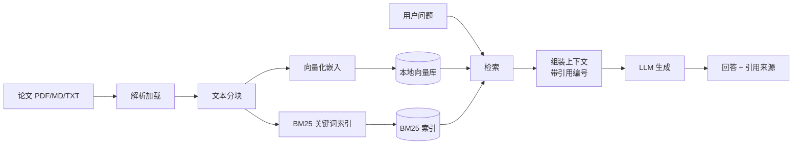

# 个人论文知识库问答系统（MVP）

基于 **RAG（检索增强生成）** 的个人论文问答系统 MVP：把你自己收集的论文（PDF / Markdown / TXT）导入本地知识库，然后直接用自然语言提问，系统会**基于论文片段回答并标注引用来源**。

支持任意 **OpenAI 兼容接口**的大模型（OpenAI / 豆包·火山方舟 / DeepSeek 等），无需自建服务。

## 功能特性

- 📄 支持导入 **PDF / Markdown / TXT** 论文，自动解析、分块（可配块大小与重叠）
- 🔍 三种检索模式：**向量检索**（语义）、**BM25**（本地关键词，无需嵌入接口）、**hybrid 混合**（默认，两者加权融合）
- 💬 两种交互方式：单次提问 `ask`、交互式多轮对话 `chat`
- 📎 回答自动标注 **[编号] 引用来源**（文件名 / 页码 / 小节标题），可追溯、降低幻觉
- 🔒 论文原文与索引默认不提交仓库，密钥通过 `.env` 管理

## 架构



## 快速开始

### 1. 安装依赖

要求 Python 3.10+。

```bash
cd paper-knowledge-qa-mvp
python -m venv .venv && source .venv/bin/activate   # Windows: .venv\Scripts\activate
pip install -r requirements.txt
```

### 2. 配置模型

```bash
cp .env.example .env
# 编辑 .env，填入你的 LLM_API_KEY 等配置
```

各家的配置示例都写在 `.env.example` 里：

| 服务商 | base_url | 对话模型 | 嵌入模型 | 说明 |
|---|---|---|---|---|
| OpenAI | `https://api.openai.com/v1` | `gpt-4o-mini` | `text-embedding-3-small` | 默认配置 |
| 豆包/火山方舟 | `https://ark.cn-beijing.volces.com/api/v3` | 推理接入点 ID（`ep-...`） | 嵌入接入点 ID 或 `doubao-embedding-large-250715` | OpenAI 兼容 |
| DeepSeek | `https://api.deepseek.com/v1` | `deepseek-chat` | 无 | 需设 `RETRIEVAL_MODE=bm25` |

> 提示：没有向量化接口的服务商（如 DeepSeek）请把 `RETRIEVAL_MODE` 设为 `bm25`，检索完全在本地完成，不需要嵌入模型。

### 3. 导入论文

把论文放进 `data/papers/`（支持子目录），然后：

```bash
# 导入整个目录
python main.py ingest --dir data/papers

# 也可以导入单个文件；--clear 表示清空旧索引后重新导入
python main.py ingest --dir examples/sample_paper.md --clear
```

### 4. 开始问答

```bash
# 单次提问
python main.py ask "什么是检索增强生成？"

# 指定检索片段数
python main.py ask "RAG 的评估指标有哪些？" --top-k 8

# 交互式多轮对话（输入 exit 退出）
python main.py chat

# 查看知识库规模
python main.py list
```

输出示例（回答末尾会附参考来源）：

```
检索增强生成（RAG）是一种将外部知识检索与大规模语言模型生成相结合的范式，
通过检索步骤从外部知识库获取证据片段，再交由模型组织答案[1][3]。……
— 参考来源 —
[1] sample_paper.md（第 1 页）· 摘要
[2] sample_paper.md（第 3 页）· 3.2 检索策略
```

## 项目结构

```
paper-knowledge-qa-mvp/
├── main.py                    # 命令行入口（ingest / ask / chat / list）
├── paper_qa/
│   ├── config.py              # 环境变量配置
│   ├── knowledge_base.py      # 知识库门面：入库 + 检索（含 hybrid 融合）
│   ├── ingestion/
│   │   ├── loader.py          # PDF / MD / TXT 解析
│   │   └── chunker.py         # 文本分块（段落 + 滑动窗口 + 标题上下文）
│   ├── llm/client.py          # OpenAI 兼容客户端（对话 + 向量化）
│   ├── store/
│   │   ├── vector_store.py    # NumPy 轻量向量库（余弦相似度，本地持久化）
│   │   └── bm25_store.py      # BM25 + jieba 本地关键词检索
│   └── qa/pipeline.py         # 检索 → 组装上下文 → 生成带引用回答
├── data/
│   ├── papers/                # 你的论文放这里（不入库）
│   └── db/                    # 向量与索引持久化（自动生成，不入库）
├── examples/sample_paper.md   # 示例论文（虚构），用于快速体验
├── tests/                     # pytest 单元测试
├── .env.example               # 模型配置模板
└── requirements.txt
```

## 检索模式说明

| 模式 | 原理 | 适用场景 |
|---|---|---|
| `vector` | 嵌入模型把文本转成向量，余弦相似度召回 | 语义检索，需要 embedding 接口 |
| `bm25` | 本地 jieba 分词 + BM25 词法匹配 | 无 embedding 接口（如 DeepSeek）、完全离线 |
| `hybrid`（默认） | 两路结果归一化后加权融合 | 兼顾精确匹配与语义泛化，效果最佳 |

## 运行测试

```bash
pip install -r requirements-dev.txt
pytest -q
```

## 路线图（非 MVP 范围）

- [ ] 重排序（rerank）模块，进一步提升召回精度
- [ ] Web UI（Streamlit / Gradio），支持在线预览论文与引用定位
- [ ] 增量入库与文档去重、更新
- [ ] 替换为正式向量数据库（Chroma / FAISS / Milvus）
- [ ] 多轮对话的上下文压缩与记忆管理

## 注意事项

- 本系统面向**个人学习研究**，导入他人论文请注意版权与使用范围，请勿公开分发受版权保护的语料。
- 检索与生成会调用云端 LLM API，产生少量费用；向量化批量上限 32 条/次。
- 请在 `.env` 中妥善保管 API Key，本仓库的 `.gitignore` 已排除 `.env`。

## License

暂未指定开源协议，如需要可自行添加（如 MIT）。
